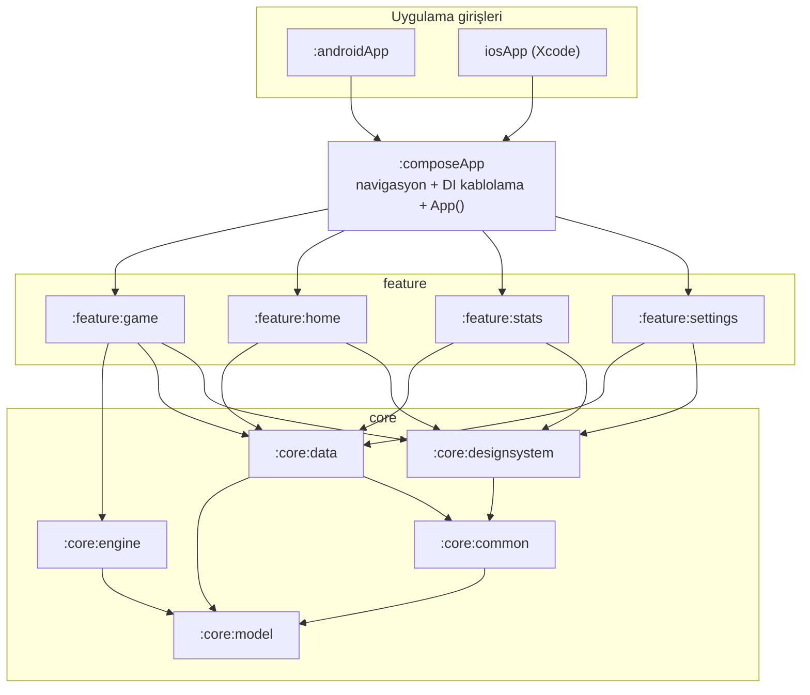
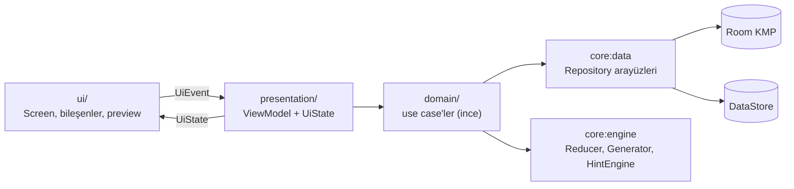

# 02 · Mimari

`Karar` (ADR-0002, 0003, 0005, 0006, 0007)

## İlkeler

1. **Çevrimdışı öncelikli.** Uygulamanın hiçbir temel işlevi ağ istemez.
2. **Motor saf Kotlin.** Bulmaca üretimi, çözüm, derecelendirme, ipucu ve oyun kuralları platform ve UI bilmez; tek başına derlenir ve JVM'de milisaniyelerde test edilir.
3. **Tek yönlü veri akışı.** UI yalnızca `UiState` çizer ve `UiEvent` yollar. Durum değişimi `ViewModel` içinde, oyun kuralları saf `GameReducer` içinde.
4. **Platform ince.** `androidApp` ve `iosApp` yalnızca giriş noktası, pencere ve platform servisleri (titreşim, paylaşım, crash raporlama) sağlar.
5. **Modül sınırları derleyiciyle korunur.** Yanlış yöne bağımlılık derlenmez (bkz. bağımlılık kuralları).

## Modül grafı



| Modül | Hedefler | Sorumluluk |
|---|---|---|
| `:core:model` | common | Saf veri tipleri: `Position`, `Grid`, `Difficulty`, `Puzzle`, `GameState`. Bağımlılığı yok. |
| `:core:engine` | common | Üretici, çözücü, derecelendirici, ipucu motoru, `GameReducer`, skor. Yalnızca `model` ve stdlib. |
| `:core:common` | common + android + ios | `DispatcherProvider`, `Clock`, `Logger` (Kermit), `Outcome<T>`, `CrashReporter` (expect/actual), `Haptics` (expect/actual). |
| `:core:data` | common + android + ios | Room KMP veritabanı, DAO'lar, DataStore ayarları, repository'ler, entity↔domain eşleyiciler, `PuzzlePool`. |
| `:core:designsystem` | common | Tema, token'lar, tipografi, temel bileşenler (`PseudokuTheme`, `SudokuBoard`, `NumberPad`, `ActionBar`, `StatTile`, `SettingRow`). Veri bilmez. |
| `:feature:game` | common | Oyun ekranı, `GameViewModel`, duraklatma ve sonuç katmanları. |
| `:feature:home` | common | Ana ekran: devam et, yeni oyun, günlük bulmaca, nasıl oynanır. |
| `:feature:stats` | common | İstatistik ekranı. |
| `:feature:settings` | common | Ayarlar ekranı. |
| `:composeApp` | common + android + ios | `App()` kökü, `NavHost`, Koin başlatma, iOS için `MainViewController()`. |
| `:androidApp` | android | `MainActivity`, splash API, Crashlytics kurulumu, imzalama. |
| `iosApp` | Xcode | SwiftUI host, `ComposeApp.framework`. |

`build-logic/` klasöründe Gradle **convention plugin**'leri bulunur (`pseudoku.kmp.library`, `pseudoku.kmp.feature`, `pseudoku.android.application`); modül build dosyaları 5-10 satırdır.

## Bağımlılık kuralları

- `feature:*` yalnızca `core:*`'a bağlanır; bir feature başka bir feature'ı **göremez**. Feature'lar arası geçiş `composeApp` içindeki navigasyon grafıyla, tipli route'larla yapılır.
- `core:*` hiçbir `feature`'ı ve `composeApp`'i göremez.
- `core:engine` ve `core:model` hiçbir Compose, Android, Koin, Room bağımlılığı taşımaz. Bu kural CI'da modülün bağımlılık listesi denetlenerek korunur.
- `core:designsystem` veri katmanını bilmez; yalnızca görsel bileşen ve token.
- Platform API'leri (`android.*`, `platform.*`) yalnızca `androidMain` / `iosMain` kaynak setlerinde ve `expect/actual` arkasında.

## Katmanlar (bir feature içinde)



- **ViewModel**: `androidx.lifecycle.ViewModel` (KMP). Tek `StateFlow<UiState>`; olaylar `fun onEvent(event: UiEvent)`. Tek seferlik etkiler (titreşim, navigasyon) `Channel<UiEffect>`.
- **Use case**: yalnızca birden fazla repository veya motor çağrısını birleştirdiğinde yazılır; aksi halde ViewModel doğrudan repository çağırır. Gereksiz katman yok.
- **Repository**: arayüz `core:data` commonMain'de, uygulama aynı modülde. Test çiftleri (fake) `core:data` `testFixtures` eşdeğeri olarak `commonTest`'te paylaşılır.

## Teknoloji yığını

| Alan | Seçim | Min. sürüm (kurulumda doğrulanır) | ADR |
|---|---|---|---|
| Dil | Kotlin Multiplatform | 2.2.x | 0002 |
| UI | Compose Multiplatform, Material 3 bileşenleri + özel tasarım sistemi | 1.9.x | 0002 |
| Build | Gradle (Kotlin DSL), version catalog, convention plugins, AGP KMP library plugin | AGP 8.13+ | 0003 |
| DI | Koin | 4.1.x | 0006 |
| Veritabanı | Room KMP + `BundledSQLiteDriver` | 2.8.x | 0007 |
| Ayarlar | DataStore Preferences (KMP) | 1.1.x | 0007 |
| Navigasyon | JetBrains Navigation Compose, `@Serializable` tipli route'lar | 2.9.x | 0011 |
| Yaşam döngüsü | `lifecycle-viewmodel-compose` (KMP) | 2.9.x | 0005 |
| Asenkron | kotlinx.coroutines + Flow | 1.10.x | 0005 |
| Serileştirme | kotlinx.serialization (JSON) | 1.9.x | 0007 |
| Tarih | kotlinx-datetime | 0.7.x | |
| Log | Kermit | 2.0.x | |
| Çökme raporu | Firebase Crashlytics (Android native; iOS'ta GitLive KMP sarmalayıcısı veya native) | | |
| Kaynaklar | Compose Multiplatform resources (`composeResources`) | | |
| Statik analiz | detekt (+ compose kuralları), ktlint (spotless), Android Lint, compose-lints | | 0012 |
| Test | kotlin-test, kotlinx-coroutines-test, Turbine, Kover, Roborazzi (opsiyonel) | | 0012 |
| CI/CD | GitHub Actions | | 0010 |

## Eşzamanlılık

- `DispatcherProvider { main, default, io }` arayüzü `core:common`'da; testlerde `UnconfinedTestDispatcher` ile değiştirilir.
- Bulmaca üretimi ve derecelendirme `default` üzerinde; veritabanı `io` üzerinde (iOS'ta `Dispatchers.IO` kotlinx-coroutines 1.8+ ile mevcuttur).
- Oyun ekranı sayaç `viewModelScope` içinde saniyelik `Tick` aksiyonu üretir; yalnızca `PLAYING` durumunda ve uygulama ön plandayken.
- Kayıt: her reducer sonucu `GameRepository.save` kuyruğuna girer; 500 ms debounce, `conflate` ile sadece son durum yazılır. Yaşam döngüsü `onStop`'ta zorla yazılır.

## Bağımlılık enjeksiyonu (Koin)

```
composeApp/di/AppModules.kt   -> allModules = listOf(commonModule, engineModule, dataModule, gameModule, homeModule, statsModule, settingsModule)
core/common/di/CommonModule   -> DispatcherProvider, Clock, Logger, CrashReporter(actual)
core/engine/di/EngineModule   -> SudokuSolver, PuzzleGenerator, DifficultyGrader, HintEngine (hepsi singleton, durumsuz)
core/data/di/DataModule       -> PseudokuDatabase(platform builder), DAO'lar, DataStore, GameRepository, StatsRepository, SettingsRepository, DailyRepository, PuzzlePool
feature/*/di/*Module          -> viewModel { GameViewModel(get(), get(), ...) }
```

Platform başlangıcı: Android `Application.onCreate` → `initKoin(androidModule(context))`; iOS `MainViewController()` öncesi `KoinInit.start(iosModule)`.

## Hata yönetimi ve log

- Repository ve use case'ler istisna fırlatmaz; `Outcome<T> = Success | Failure(error: AppError)` döner. `AppError` sealed: `Storage`, `Corrupted`, `Unexpected`.
- Kayıt hatası oyunu durdurmaz: kullanıcıya sessiz, Crashlytics'e non-fatal, Kermit'e warn.
- Motor **asla** istisna fırlatmaz; geçersiz girdi `require` ile sadece debug'da yakalanır, release'de güvenli varsayılan.
- Log seviyesi: debug build `Verbose`, release `Warn`; PII loglanmaz (loglanacak PII yok).

## Navigasyon

- `composeApp/navigation/PseudokuNavHost.kt`; route'lar `@Serializable` nesne/data class: `Home`, `Game(gameId: String?, difficulty: String?, dailyDate: String?)`, `Stats`, `Settings`, `HowToPlay`.
- Her feature `fun NavGraphBuilder.gameGraph(onNavigate: (Route) -> Unit)` benzeri bir genişletme sunar; feature'lar birbirinin route'unu bilmez, `composeApp` bağlar.
- Geri davranışı: oyun ekranından çıkış otomatik kaydeder, onay sormaz (ADR-0005 ilkesi: kayıp olmayan yerde diyalog yok).

## Yapılandırma

- Build tipleri: `debug`, `release`. Release: R8 açık, kaynak küçültme açık, imza CI gizli anahtarlarından.
- Derleme zamanı sabitleri (sürüm adı, analitik açık/kapalı) `BuildKonfig` veya `expect/actual` `AppConfig` ile.
- Gizli bilgi (keystore, Play servis hesabı, App Store API anahtarı) **hiçbir zaman** repoya girmez; GitHub Secrets.

## Performans kararları

- Tahta **tek `Canvas` composable**: 81 ayrı composable yerine `drawWithCache` ile çizim (ADR-0009). Seçim ve vurgulama değişince yalnızca çizim yeniden yapılır, ölçüm/yerleşim yapılmaz.
- `GameUiState` tamamen immutable; `@Immutable`/`@Stable` işaretli; listeler `kotlinx.collections.immutable`.
- Vurgulama kümeleri (`sameDigitCells`, `peerCells`) ViewModel'de türetilir, UI'da hesaplanmaz.
- `PuzzlePool`: uygulama açılışında ve her tüketimde arka planda zorluk başına 1 bulmaca üretilip bellekte tutulur; "Yeni oyun" anında açılır. Günlük bulmaca tarihe göre deterministik olduğundan havuza girmez.
- Soğuk başlangıç: Koin modülleri tembel (`createdAtStart = false`), Room açılışı ilk sorguda.
