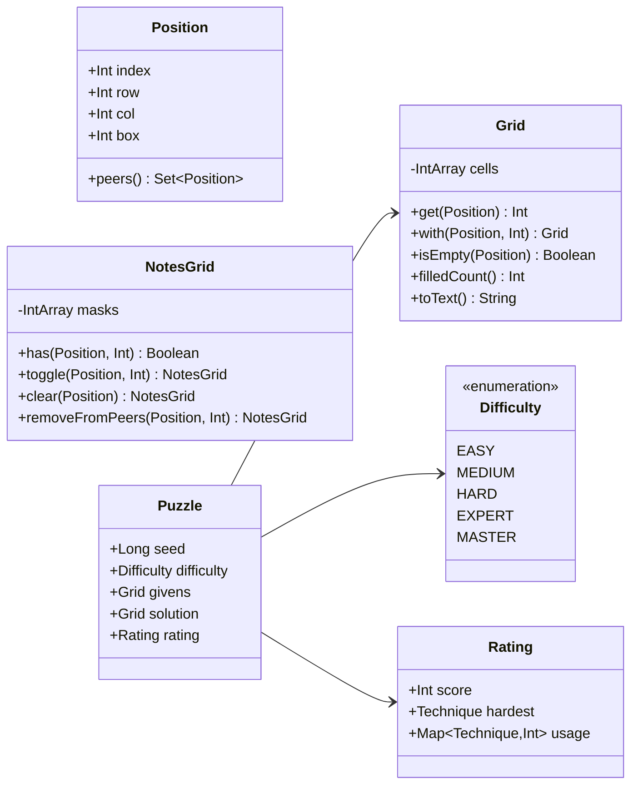
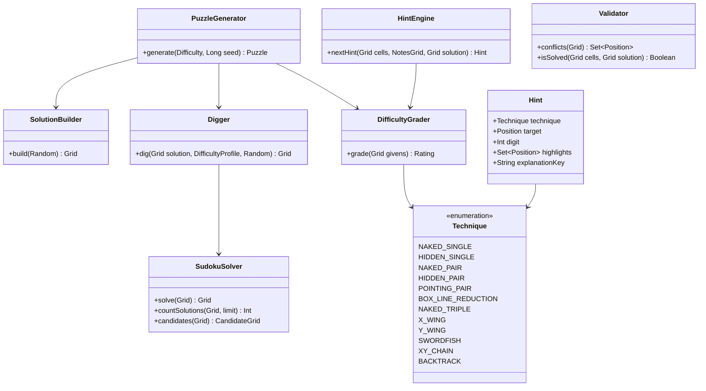
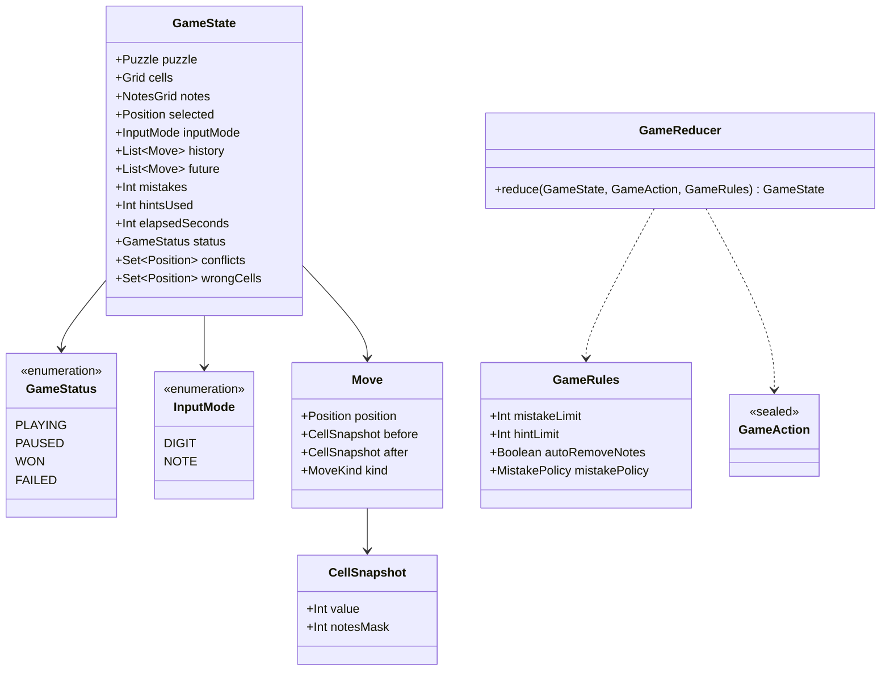
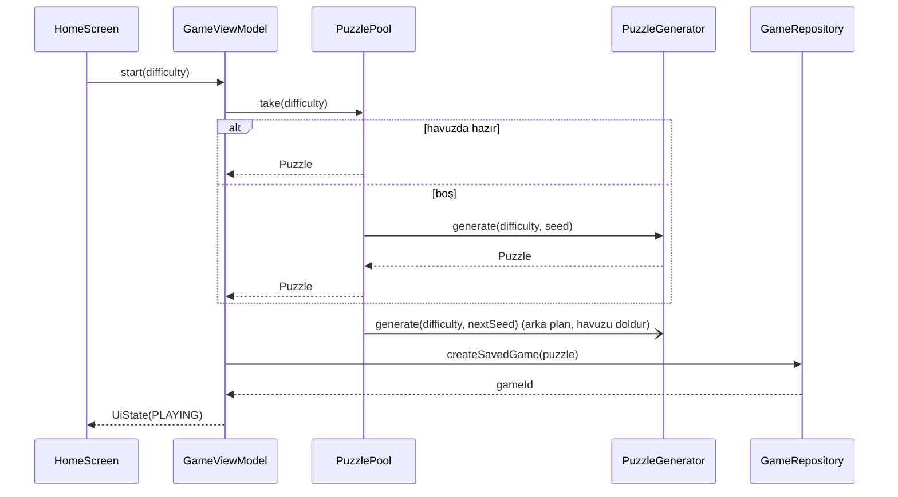
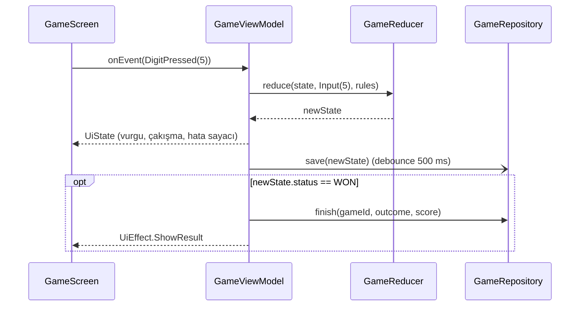
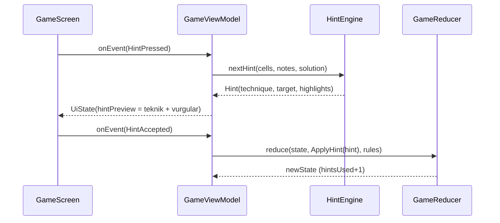

# 03 · Alan modeli ve motor

`Karar` (ADR-0004)

Motor `:core:engine` içinde, tipler `:core:model` içinde yaşar. İkisi de platform ve UI bilmez. Her şey **deterministiktir**: aynı `seed` aynı bulmacayı üretir (günlük bulmaca buna dayanır).

## Temel tipler



- `Position` bir `value class`; `index` 0..80. Eski projedeki `satır*10+sütun` kodlaması terk edildi.
- `Grid` 81 elemanlı `IntArray` sarmalar, 0 = boş. Immutable; `with` yeni kopya döner (81 int kopyalamak ucuzdur).
- `NotesGrid` her hücre için 9 bitlik maske (bit n = rakam n+1).
- `Grid.toText()` 81 karakterlik `"530070000600195000..."` dizesi; veritabanı ve test fixture'ları bu biçimi kullanır.

## Motor bileşenleri



### SudokuSolver

Bit maskeli geri izleme (satır/sütun/kutu başına 9 bitlik kullanılmış-rakam maskesi, en az adaylı hücre önce). `countSolutions(limit = 2)` teklik denetimi için ikinci çözümü bulur bulmaz durur. Hedef: tipik bulmacada < 1 ms, en kötü durumda < 20 ms (JVM).

### SolutionBuilder

Boş tahtaya rastgele sıralı adaylarla geri izleme; her zaman geçerli tam bir çözüm üretir. `Random` dışarıdan gelir (determinizm).

### Digger

1. 81 hücre 180° dönme simetrisiyle 41 çifte ayrılır; çiftler `Random` ile karıştırılır.
2. Her çift için: değerleri kaldır, `countSolutions(limit = 2) == 1` ise kaldırma kalıcı, değilse geri koy.
3. Profilin hedef ipucu aralığına inince dur.

| Zorluk | Hedef ipucu (given) | Derece bandı (grader) |
|---|---|---|
| EASY | 38-45 | yalnızca singles |
| MEDIUM | 32-37 | + naked/hidden pair, pointing |
| HARD | 28-31 | + box-line, naked triple |
| EXPERT | 25-27 | + X-Wing, Y-Wing |
| MASTER | 22-25 | + Swordfish, XY-Chain veya backtrack gerektirir |

İpucu sayısı tek başına zorluk belirlemez; son söz grader'ındır.

### DifficultyGrader

İnsan stratejisi çözücüsü: teknikleri kolaydan zora sırayla dener, uygulanan her tekniği sayar, ilerleme durunca bir sonraki tekniğe geçer. Çıktı `Rating(score, hardest, usage)`. `score` her tekniğin ağırlığı × kullanım sayısı. Band dışına düşen bulmaca atılır; `PuzzleGenerator` alt-seed türeterek yeniden dener (üst sınır 40 deneme; aşılırsa bir alt bandın bulmacası döner ve bu durum loglanır).

### HintEngine

`DifficultyGrader` ile aynı teknik sırasını kullanır: mevcut tahtada uygulanabilen **ilk** tekniği bulur ve `Hint` döner. Hint iki aşamalıdır (UI kararı): önce teknik adı ve vurgulanan hücreler, oyuncu isterse rakam. Hiçbir teknik uygulanamıyorsa (oyuncu yanlış not bırakmışsa) `BACKTRACK` ile çözümden doğrudan hücre verir ve bunu söyler.

### Validator

- `conflicts`: aynı satır/sütun/kutuda aynı rakam olan hücreler (kural ihlali).
- `isSolved`: tüm hücreler dolu ve çözümle eşit.
- Hata tanımı (ayar): **çözüme göre** (varsayılan, mağaza standardı) veya **yalnızca kural çakışması**.

## Oyun durumu ve reducer



`GameAction` alt tipleri: `Select(position)`, `Input(digit)`, `ToggleNote(digit)`, `Erase`, `Undo`, `Redo`, `ApplyHint(hint)`, `ToggleInputMode`, `Tick`, `Pause`, `Resume`, `Restart`.

Reducer kuralları:

- Verilen (given) hücreye giriş yok sayılır.
- `Input(d)`: hücre `d` ise temizler (toggle); değilse yazar, `autoRemoveNotes` açıksa komşu notlardan `d` silinir (bu da aynı `Move` içine kaydedilir, tek geri alma ile döner).
- Hata: `mistakePolicy == SOLUTION` ise `cells[p] != solution[p]` olduğunda `mistakes++`, hücre `wrongCells`'e girer; limit dolunca `FAILED`.
- `Undo` / `Redo`: `history` ve `future` yığınları; yeni hamle `future`'ı temizler.
- `ApplyHint`: hücreyi çözümle doldurur, `hintsUsed++`, `Move(kind = HINT)` olarak geçmişe girer.
- Son hücre dolup `isSolved` sağlanınca `WON`; sayaç durur.
- `Tick` yalnızca `PLAYING`'de `elapsedSeconds++`.

## Skor

`ScoreCalculator.score(state)`; yalnızca sonuç ekranında ve istatistikte gösterilir, oyun sırasında dikkat dağıtmaz.

```
base(difficulty)      EASY 500, MEDIUM 1000, HARD 1800, EXPERT 3000, MASTER 5000
timeBonus             max(0, base - elapsedSeconds * k(difficulty))
mistakePenalty        100 * mistakes
hintPenalty           150 * hintsUsed
score = base + timeBonus - mistakePenalty - hintPenalty   (min 0)
```

## Sıra diyagramları

### Yeni oyun



### Hamle



### İpucu



## Günlük bulmaca

`seed = hash64("pseudoku-daily", date.toString())`, zorluk haftanın gününe göre döner (Pzt EASY → Paz EXPERT, Cmt MASTER yerine HARD; tablo `DailyRules`'ta). Aynı tarih her cihazda aynı bulmacayı verir; sunucu gerekmez. Seri: ardışık günlerde `WON` sonuçlanan günlük bulmaca sayısı.

## Eski projeden taşınan bilgi

| Eski | Yeni | Not |
|---|---|---|
| 37 / 32 / 27 ipucu (EASY/MEDIUM/HARD) | Profil tablosu + grader | İpucu sayısı tek ölçüt değil |
| +50 / −100 puan | `ScoreCalculator` | Skor sonuçta, oyun içinde değil |
| 3 hata, 3 ipucu | `GameRules` varsayılanı | Ayarlardan değiştirilebilir |
| Tek haneli not | 9 bitlik `NotesGrid` | |
| Rastgele ipucu hücresi | Teknik tabanlı `HintEngine` | |
| Teklik kontrolü yok | `countSolutions(limit=2)` | |
