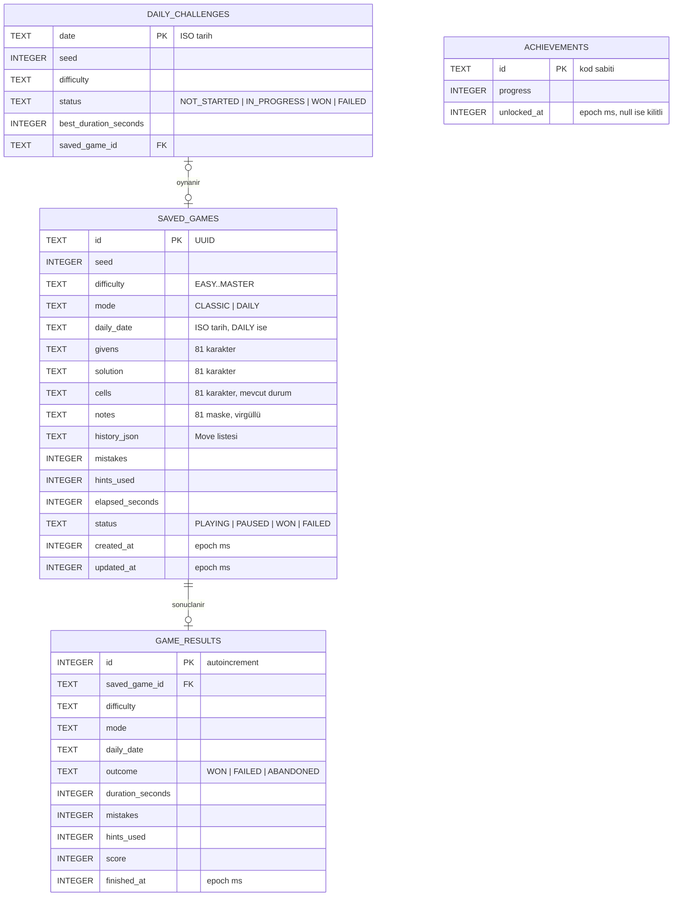
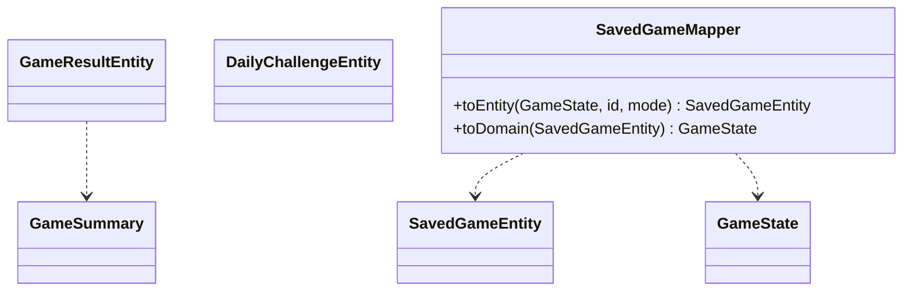

# 04 · Veri modeli

`Karar` (ADR-0007)

Kalıcılık iki parçadır: **Room KMP** (oyun kayıtları, sonuçlar, günlük bulmaca, başarımlar) ve **DataStore Preferences** (kullanıcı ayarları). İkisi de yalnızca `:core:data` içinden erişilir; feature'lar repository arayüzlerini görür, entity'leri görmez.

## ER diyagramı



## Tablolar

### `saved_games`

Devam eden ve biten oyunların tam durumu. Aynı anda en fazla **bir** `CLASSIC` oyun `PLAYING`/`PAUSED` olabilir (yeni oyun başlatılırsa eski `ABANDONED` sonuçlanır ve `game_results`'a yazılır). `DAILY` oyunlar tarih başına birdir.

- `notes`: 81 adet int maskesi, `"0,0,18,0,..."` biçiminde. JSON yerine CSV, boyut ve hız için.
- `history_json`: `List<Move>` kotlinx.serialization ile. Geri alma geçmişi kalıcıdır; uygulama kapanıp açılınca geri al çalışır.
- İndeks: `(status, updated_at)` "devam et" sorgusu için; `(mode, daily_date)` tekil.
- Biten oyunlar 30 gün sonra silinir (`GameRepository.purgeFinished`), sonuçları `game_results`'ta kalır.

### `game_results`

İstatistiğin kaynağı. Yalnızca ekleme yapılır, güncellenmez. İndeks: `(difficulty, finished_at)`, `(mode, daily_date)`.

İstatistik sorguları türetilir, ayrı özet tablosu tutulmaz (veri küçük; binlerce satırda bile SQLite milisaniyeler):

| Metrik | Sorgu |
|---|---|
| Oynanan / kazanılan | `COUNT`, `SUM(outcome='WON')` zorluk bazında |
| En iyi süre | `MIN(duration_seconds) WHERE outcome='WON'` |
| Ortalama süre | `AVG(duration_seconds) WHERE outcome='WON'` |
| Hatasız oyun | `COUNT WHERE outcome='WON' AND mistakes=0` |
| Günlük seri | `daily_challenges` üzerinden Kotlin'de hesaplanır (ardışık `WON` günler) |

### `daily_challenges`

Tarih başına tek satır; ilk açılışta oluşur. `seed` ve `difficulty` `DailyRules`'tan deterministik hesaplanır ama ileride kural değişirse eski günlerin bozulmaması için satırda saklanır.

### `achievements`

1.1 için; şema 1.0'da oluşturulur ki migrasyon gerekmesin. `id` kod sabiti (`FIRST_WIN`, `NO_MISTAKE_HARD`, `STREAK_7`, ...).

## Entity ↔ domain eşleme



`Grid.toText()` / `Grid.parse()` ve `NotesGrid.toCsv()` / `parse()` dönüşümleri `:core:model` içinde; mapper yalnızca alanları taşır.

## Repository arayüzleri (`:core:data` commonMain)

```kotlin
interface GameRepository {
    fun observeContinuable(): Flow<GameSummary?>          // ana ekrandaki "Devam et"
    suspend fun load(id: String): Outcome<GameState>
    suspend fun create(puzzle: Puzzle, mode: GameMode, dailyDate: LocalDate? = null): Outcome<String>
    suspend fun save(id: String, state: GameState): Outcome<Unit>
    suspend fun finish(id: String, state: GameState, outcome: GameOutcome, score: Int): Outcome<Unit>
    suspend fun purgeFinished(olderThan: Instant)
}
interface StatsRepository {
    fun observeStats(): Flow<Stats>                        // tüm zorluklar
    fun observeDailyStreak(): Flow<DailyStreak>
}
interface DailyRepository {
    suspend fun challengeFor(date: LocalDate): DailyChallenge
    fun observeMonth(yearMonth: YearMonth): Flow<List<DailyChallenge>>
}
interface SettingsRepository {
    val settings: Flow<Settings>
    suspend fun update(transform: (Settings) -> Settings)
}
```

## DataStore anahtarları

| Anahtar | Tip | Varsayılan |
|---|---|---|
| `theme_mode` | `SYSTEM / LIGHT / DARK` | `SYSTEM` |
| `palette` | string (09'daki palet kimliği) | tasarım yönünün varsayılanı |
| `highlight_peers` | bool | true |
| `highlight_same_digit` | bool | true |
| `show_conflicts` | bool | true |
| `mistake_policy` | `SOLUTION / RULES_ONLY` | `SOLUTION` |
| `mistake_limit_enabled` | bool | true |
| `mistake_limit` | int | 3 |
| `hint_limit_enabled` | bool | true |
| `hint_limit` | int | 3 |
| `auto_remove_notes` | bool | true |
| `timer_visible` | bool | true |
| `haptics_enabled` | bool | true |
| `sound_enabled` | bool | false |
| `language` | `SYSTEM / tr / en` | `SYSTEM` |
| `onboarding_done` | bool | false |
| `last_difficulty` | enum | `MEDIUM` |
| `analytics_opt_in` | bool | true (ilk açılışta sorulur) |

## Migrasyon politikası

- `exportSchema = true`; şemalar `core/data/schemas/` altında repoda tutulur ve Room'un otomatik migrasyon testi CI'da çalışır.
- Eski projedeki `pseudokudb.sqlite3` ile uyumluluk **hedeflenmez** (uygulama hiç yayınlanmadı). Yeni veritabanı adı `pseudoku.db`, sürüm 1.
- Yıkıcı migrasyon (`fallbackToDestructiveMigration`) yalnızca debug build'de.

## Platform farkları

- Veritabanı dosya yolu `expect fun databasePath(): String` (Android: `context.getDatabasePath`, iOS: `NSDocumentDirectory`).
- Sürücü her iki platformda `BundledSQLiteDriver`; davranış farkı olmaz, JVM testleri aynı sürücüyle koşar.
- DataStore dosya yolu aynı şekilde `expect/actual`.
