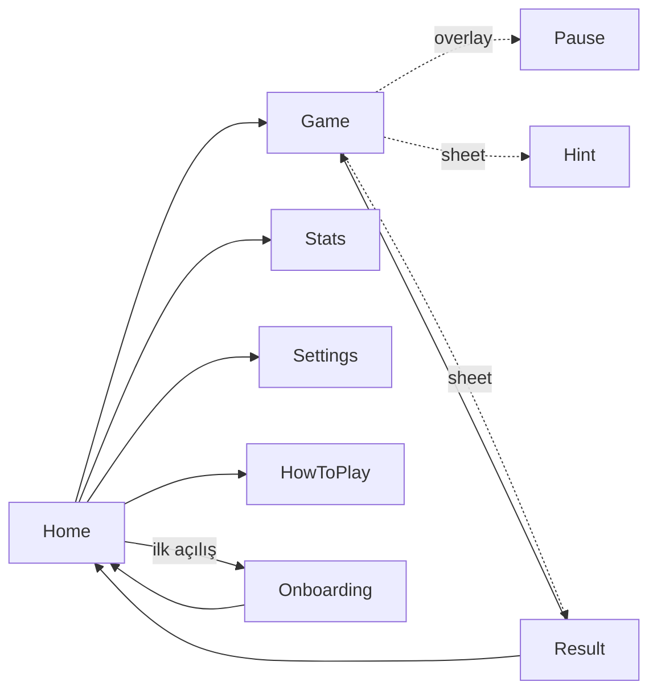
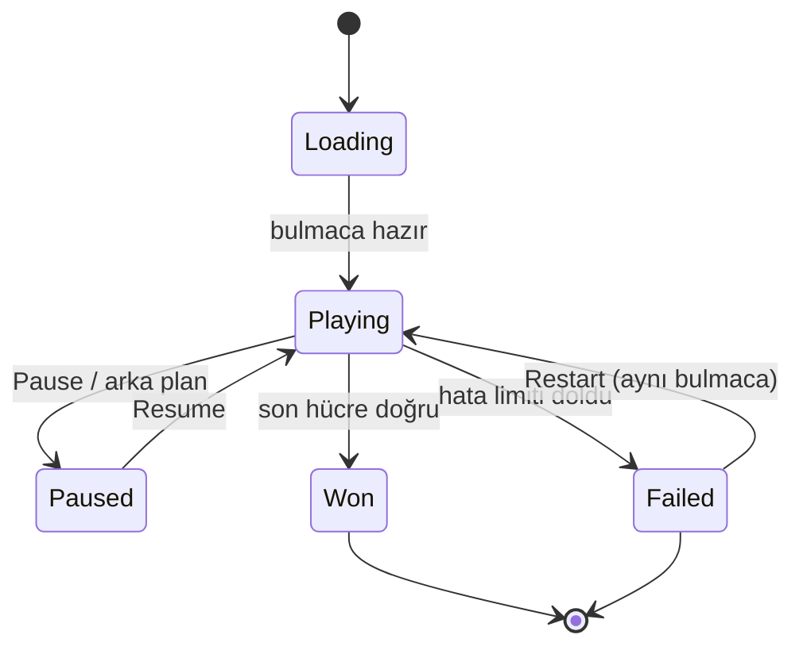

# 05 · Arayüz ve navigasyon

`Karar` (ADR-0009, 0011); görsel yön için bkz. [09](09-ui-design-direction.md).

## Ekran envanteri

| Ekran | Modül | İçerik |
|---|---|---|
| Home | `feature:home` | "Devam et" kartı (zorluk, süre, ilerleme), yeni oyun + zorluk seçimi, günlük bulmaca kutusu (tarih, durum, seri), istatistik ve ayarlar girişleri |
| Game | `feature:game` | Üst şerit (zorluk, hata sayacı, sayaç, duraklat), tahta, aksiyon çubuğu (geri al, sil, not, ipucu), rakam pedi (kalan adet ile) |
| Pause (overlay) | `feature:game` | Tahta gizli, devam / yeniden başla / ana ekran |
| Result (sheet) | `feature:game` | Kazanıldı: süre, hata, ipucu, skor, en iyi süre karşılaştırması, yeni oyun / ana ekran. Kaybedildi: yeniden başla (aynı bulmaca) / yeni oyun |
| Hint (sheet) | `feature:game` | Teknik adı, kısa açıklama, vurgulanan hücreler; "Rakamı göster" ikinci adım |
| Stats | `feature:stats` | Zorluk sekmeleri; oynanan, kazanılan, kazanma oranı, en iyi, ortalama, hatasız; günlük seri ve ay takvimi |
| Settings | `feature:settings` | Görünüm, oyun kuralları, yardımcılar, geri bildirim (titreşim/ses), dil, hakkında, gizlilik |
| How to play | `feature:home` | Kurallar + ilk teknikler, kısa kartlar |
| Onboarding | `feature:home` | İlk açılışta 3 adım, atlanabilir |

Splash **activity yok**; Android 12+ Splash Screen API ve iOS LaunchScreen kullanılır. Eski projedeki 4 saniyelik bekleme kaldırıldı.

## Navigasyon grafı



Route'lar (`composeApp/navigation/Routes.kt`):

```kotlin
@Serializable object Home
@Serializable data class Game(val gameId: String? = null, val difficulty: Difficulty? = null, val dailyDate: String? = null)
@Serializable object Stats
@Serializable object Settings
@Serializable object HowToPlay
```

`Game` üç şekilde açılır: kayıtlı oyunla (`gameId`), yeni oyunla (`difficulty`), günlük bulmacayla (`dailyDate`). Tam olarak biri dolu olmalıdır; ViewModel bunu `init`'te doğrular.

## Oyun durum makinesi



## UI durumu

```kotlin
@Immutable
data class GameUiState(
    val board: BoardUiModel,          // 81 hücre: değer, given mi, notlar, görsel durum (normal/selected/peer/sameDigit/conflict/wrong/hint)
    val difficulty: Difficulty,
    val elapsed: String,              // "12:34", timer_visible kapalıysa null
    val mistakes: Int, val mistakeLimit: Int?,
    val hintsLeft: Int?,
    val inputMode: InputMode,
    val digitCounts: List<Int>,       // 1..9 için kalan adet; 0 olanlar pedde pasif
    val canUndo: Boolean, val canRedo: Boolean,
    val status: GameStatus,
    val hintPreview: HintUiModel? = null,
    val result: ResultUiModel? = null,
)
```

Hücre görsel durumu ViewModel'de hesaplanır; `Canvas` yalnızca çizer. Seçim değişince yeni `BoardUiModel` üretilir (81 küçük nesne; `ImmutableList`).

## Tahta bileşeni (ADR-0009)

- `SudokuBoard(model, onCellTap, modifier)` tek `Canvas`; `pointerInput` ile dokunma hücreye çevrilir.
- Çizim sırası: arka plan → vurgulu hücre dolguları → ince çizgiler → kalın kutu çizgileri → notlar (3×3 küçük rakam) → rakamlar → çakışma/hata işaretleri.
- Metin `TextMeasurer` ile önceden ölçülür ve `drawWithCache` içinde saklanır; boyut değişmedikçe yeniden ölçülmez.
- Erişilebilirlik: her hücre için `semantics` düğümü (`contentDescription = "Satır 3, sütun 5, boş, notlar 2 ve 4"`, `onClick`). TalkBack ile tahta gezilebilir.
- Animasyon: doğru girişte kısa ölçek (120 ms), tamamlanan satır/sütun/kutuda dalga (ayar: `reduce_motion` sistem bayrağına uyar), kazanmada tahta dolgusu. Hepsi 300 ms altı.

## Tasarım sistemi yapısı (`:core:designsystem`)

```
theme/     PseudokuTheme, ColorScheme (palet başına), Typography, Shapes, Spacing, Motion
tokens/    renk rolleri (surface, onSurface, boardLine, boardBoxLine, cellSelected, cellPeer, cellSameDigit, cellConflict, cellWrong, digitGiven, digitUser, note, accent), spacing 4 dp ızgarası, köşe yarıçapları, süreler
components/ SudokuBoard, NumberPad, ActionBar, DifficultyChip, StatTile, SettingRow, PrimaryButton, SecondaryButton, Sheet, TopBar
preview/   her bileşenin açık/koyu preview'ı
```

Renk rolleri paletten bağımsızdır; palet yalnızca değerleri doldurur. Bileşenler rol adıyla renk alır, asla hex ile.

## Erişilebilirlik

- Dokunma hedefi ≥ 44 dp: 360 dp genişlikte hücre 36-38 dp olur; tahta kenar boşluğu 8 dp'ye düşürülerek hücre ≥ 38 dp tutulur, ped tuşları ≥ 48 dp.
- Kontrast: tüm metin 4.5:1; vurgulama dolguları üzerindeki rakamlar da dahil (palet tasarımında kontrol edilir).
- Renk körlüğü: çakışma ve hata yalnızca renkle değil, şekille de işaretlenir (alt çizgi / köşe işareti). Vurgu renkleri mavi/turuncu ekseninde, kırmızı/yeşil ikilisinden kaçınılır.
- Dinamik yazı tipi: tahta rakamları hücreye göre ölçeklenir (sistem ölçeği 1.3'e kadar uygulanır, sonrası sabit); diğer metinler sistemi izler.
- `reduce_motion` açıksa animasyonlar anında geçişe döner.
- Titreşim ve ses ayrı ayrı kapatılabilir.

## Yerelleştirme

- Compose Multiplatform resources: `composeResources/values/strings.xml` (en), `values-tr/strings.xml`.
- Kodda sabit metin yasak; detekt özel kuralı `Text("...")` literal kullanımını yakalar.
- Çoğul ve sayı biçimleri `plurals` ve `kotlinx-datetime` ile; süre biçimi `mm:ss`, saat aşınca `h:mm:ss`.
- Teknik açıklamaları (`explanationKey`) da kaynak dosyasında; motor metin değil anahtar döner.
