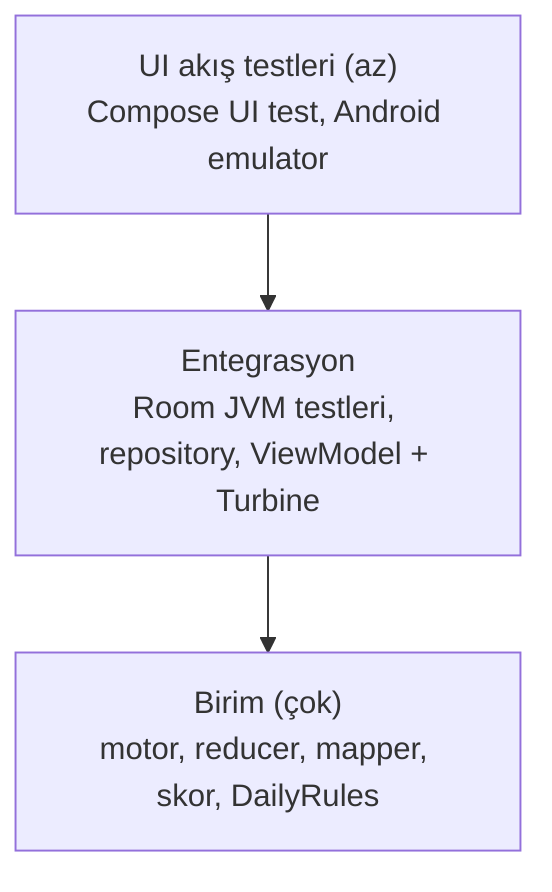

# 06 · Test ve kalite

`Karar` (ADR-0012)

## Test piramidi

| Katman | Araç | Nerede koşar | Kapsam hedefi |
|---|---|---|---|
| `core:engine`, `core:model` | kotlin-test, özellik tabanlı döngüler | JVM, her PR | ≥ 90 % satır; `GameReducer` 100 % |
| `core:data` | Room `BundledSQLiteDriver` ile JVM testleri, in-memory | JVM, her PR | ≥ 80 % |
| `feature:*` ViewModel | kotlinx-coroutines-test, Turbine, fake repository'ler | JVM, her PR | ≥ 70 % |
| `core:designsystem` | Compose preview + Roborazzi ekran görüntüsü testleri (Faz 3'te eklenir) | JVM (Robolectric) | kritik bileşenler |
| Akış | Compose UI test: yeni oyun → hamle → ipucu → kazan | Android emulator, gecelik ve release öncesi | 3-5 senaryo |
| Performans | motor benchmark (JVM), Macrobenchmark soğuk başlangıç (Faz 4) | manuel / gecelik | bütçeler 01'de |

## Motor testleri (ayrıntı)

- **Determinizm:** aynı `(difficulty, seed)` iki kez üretilir, birebir eşit olmalı. Her zorluk için 20 seed.
- **Teklik:** 200 rastgele seed × 5 zorluk; her bulmacada `countSolutions(limit = 2) == 1`.
- **Derece bandı:** üretilen her bulmacanın `rating.hardest` istenen bandda.
- **Altın bulmacalar:** bilinen 81 karakterlik bulmacalar ve beklenen teknik (örn. klasik X-Wing örneği) `resources/golden/*.txt`; grader ve hint engine beklenen tekniği bulmalı.
- **Çözücü doğruluğu:** çözüm her satır/sütun/kutuda 1..9 permutasyonu; verilenleri korur.
- **Reducer tablosu:** her `GameAction` için verilen durum → beklenen durum; kıyı durumları: given hücreye giriş, limitte hata, boş geçmişte undo, not modunda given hücre, son hücrede yanlış rakam.
- **Performans:** HARD üretim ortalaması < 150 ms, p95 < 400 ms (JVM, CI runner); aşılırsa test başarısız.

## Statik analiz

- **detekt**: resmi kural seti + `detekt-formatting` + Compose kuralları (`io.nlopez.compose.rules`). Yapılandırma `config/detekt/detekt.yml`. Özel kural: UI'da string literal yasak.
- **ktlint** (spotless üzerinden), `.editorconfig` resmi Kotlin stili.
- **Android Lint** `warningsAsErrors = true`, baseline yok.
- **Bağımlılık denetimi:** `:core:engine` ve `:core:model` için Gradle görevi `checkEngineDependencies`, izinli listede olmayan bağımlılık varsa build kırılır.
- **Kover** modül başına eşik; `koverVerify` CI'da zorunlu.

## Tanım: bir PR ne zaman biter

1. CI yeşil: derleme, detekt, ktlint, lint, testler, kover eşikleri.
2. Yeni davranış için test var; hata düzeltmesi için önce kırmızı test.
3. Kullanıcıya görünen metin TR ve EN kaynaklarda.
4. Erişilebilirlik: yeni etkileşimli bileşenin `contentDescription`/`semantics` tanımı var.
5. Mimari karar değiştiyse ADR eklendi/güncellendi.
6. PR açıklaması şablona uygun; ekran değişiyorsa açık/koyu ekran görüntüsü.

## Kalite izleme (üretim)

- Crashlytics: crash-free session ≥ 99.5 %; yeni sürümde ilk 48 saat izlenir.
- Analitik olaylar (opt-in): `game_start(difficulty, mode)`, `game_finish(outcome, duration, mistakes, hints)`, `hint_used(technique)`, `daily_complete`. PII yok.
- ANR ve aşırı yavaş kare metrikleri Play Console / Xcode Organizer.
