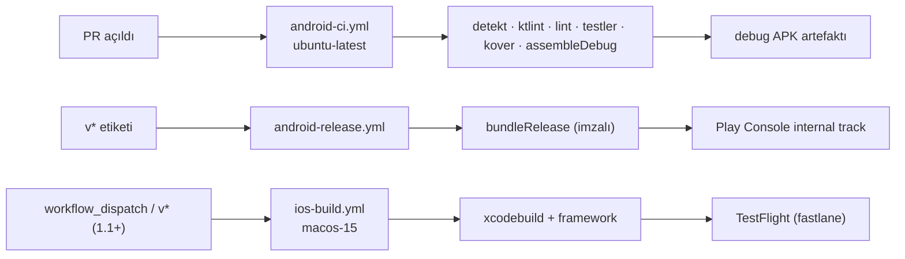

# 07 · CI/CD ve sürüm

`Karar` (ADR-0010, 0012)

## Dallanma ve commit

- Trunk tabanlı: `main` korumalı (PR zorunlu, CI yeşil zorunlu, en az 1 onay; tek geliştiricide kendi onayı = PR açıklamasını okuyup merge).
- Kısa ömürlü dallar: `feat/engine-solver`, `fix/board-tap-offset`, `docs/...`, `chore/...`.
- Conventional Commits: `feat:`, `fix:`, `docs:`, `test:`, `chore:`, `refactor:`, `perf:`. Changelog bunlardan üretilir.
- Eski native kod `main`'de kalır; KMP iskeleti ayrı dalda kurulur ve **tek PR ile eski `app/` modülü silinerek** `main`'e girer (ADR-0001). Tarih git'te kalır.

## İş akışları



### `android-ci.yml` (her PR ve `main` push)

```yaml
name: android-ci
on:
  pull_request:
  push:
    branches: [main]
concurrency:
  group: ci-${{ github.ref }}
  cancel-in-progress: true
jobs:
  build:
    runs-on: ubuntu-latest
    timeout-minutes: 30
    steps:
      - uses: actions/checkout@v4
      - uses: actions/setup-java@v4
        with: { distribution: temurin, java-version: 21 }
      - uses: gradle/actions/setup-gradle@v4
        with: { cache-read-only: ${{ github.ref != 'refs/heads/main' }} }
      - run: ./gradlew detekt spotlessCheck lint
      - run: ./gradlew allTests koverVerify
      - run: ./gradlew :androidApp:assembleDebug
      - uses: actions/upload-artifact@v4
        with: { name: debug-apk, path: androidApp/build/outputs/apk/debug/*.apk }
```

`allTests` KMP modüllerinde JVM/Android birim testlerini çalıştırır; iOS testleri Linux runner'da koşmaz, bu beklenen durumdur (motor ortak kodu JVM'de test edilir).

### `android-release.yml` (`v*` etiketi)

- Keystore base64 gizli anahtardan dosyaya çözülür; `bundleRelease` imzalanır.
- `versionCode` = etiketten türetilen monoton sayı (`GITHUB_RUN_NUMBER` + taban), `versionName` = etiket.
- `r0adkll/upload-google-play` ile **internal** track'e yükleme; production'a geçiş her zaman elle.
- Gizli anahtarlar: `ANDROID_KEYSTORE_B64`, `ANDROID_KEYSTORE_PASSWORD`, `ANDROID_KEY_ALIAS`, `ANDROID_KEY_PASSWORD`, `PLAY_SERVICE_ACCOUNT_JSON`, `GOOGLE_SERVICES_JSON_B64` (Firebase).

### `ios-build.yml` (1.1, Android 1.0 sonrası)

- `macos-15` runner, Xcode seçimi `maxim-lobanov/setup-xcode`.
- `./gradlew :composeApp:linkReleaseFrameworkIosArm64` (simülatör için `IosSimulatorArm64`).
- `xcodebuild -project iosApp/iosApp.xcodeproj -scheme iosApp -configuration Release -sdk iphoneos archive`.
- İmzalama: App Store Connect API anahtarı (`ASC_KEY_ID`, `ASC_ISSUER_ID`, `ASC_KEY_P8_B64`) + sertifika ve provisioning profile `fastlane match` ile özel bir repoda şifreli. Mac'siz tek seferlik kurulum: sertifika isteği (CSR) OpenSSL ile Windows'ta üretilebilir, Apple Developer portalından sertifika indirilir; match bunları saklar.
- `fastlane pilot upload` ile TestFlight.
- Simülatör testi lokal Mac olmadan yapılamaz; CI'da `xcodebuild test` ile UI testleri koşturulur, görsel doğrulama TestFlight üzerinden gerçek cihazda.

## Sürümleme

- SemVer: `1.0.0` Android ilk yayın, `1.1.0` iOS + başarımlar, `1.2.0` bulut (karar bekliyor).
- Her etiket için GitHub Release; notlar conventional commit'lerden `release-please` veya elle.

## Yayın kontrol listesi (1.0)

1. CI yeşil, kover eşikleri geçti, lint sıfır uyarı.
2. Release build gerçek cihazda (en az 2 Android sürümü, biri düşük segment) 30 dakika oynandı; arka plan/ön plan, döndürme (portre kilitli), kesinti (arama) senaryoları.
3. R8 ile crash yok; `mapping.txt` Crashlytics'e yüklendi.
4. Play Console: uygulama imzası, veri güvenliği formu, gizlilik politikası URL'si, ekran görüntüleri (6.5" ve 10"), kategori, içerik derecelendirmesi.
5. **Yeni kişisel Play geliştirici hesapları** (Kasım 2023 sonrası açılan) production'a geçmeden önce en az 12 testçiyle 14 gün kapalı test zorunludur; takvimde bu süre ayrı tutulur.
6. Etiket `v1.0.0`, release notları, `main` koruması kontrolü.
